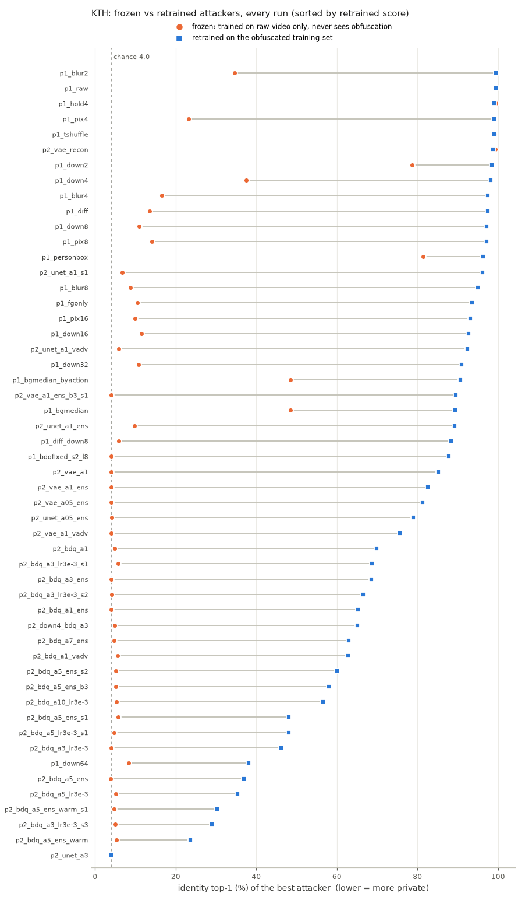
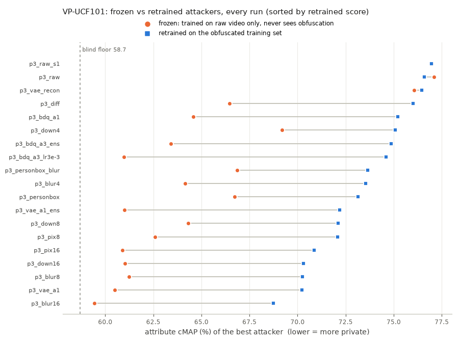

# Frozen vs retrained attackers

Every finished run is scored twice by the same attacker architectures:

- **frozen**: trained once on raw video, then tested on the obfuscated test set. It has never seen an obfuscated frame (the protocol in Ilic et al., "Selective, Interpretable and Motion Consistent Privacy Attribute Obfuscation for Action Recognition").
- **retrained**: a fresh model of the same architecture trained on the obfuscated training set, as a real attacker who gets the released data would do.

Privacy is the best attacker's score (frame ResNet-50 or video R3D-18; DINOv2 runs are attack-only and have no frozen score). Generated by `scripts/frozen_attackers.py` from `results/runs/*/result.json`.

## KTH (identity top-1 (%); chance 4.0)

- 54 obfuscated runs. Median gap retrained - frozen: **62.4 points**.
- In 43 of 54 runs the frozen attacker recovers less than a quarter of what the retrained one does (above the floor): under the frozen protocol they would look private.

| run | split | obfuscation | frozen action | frozen privacy (frame / video) | **frozen best** | **retrained best** | retrained action |
|---|---|---|---:|---:|---:|---:|---:|
| p1_raw_seq | seq | `raw` | 99.0 | 100.0 / 100.0 | **100.0** | **100.0** | 99.2 |
| p1_blur2 | ilic | `blur (sigma 2)` | 62.2 | 34.6 / 12.0 | **34.6** | **99.5** | 97.7 |
| p1_raw | ilic | `raw` | 97.2 | 99.3 / 99.3 | **99.3** | **99.5** | 97.5 |
| p1_hold4 | ilic | `hold (k 4)` | 95.2 | 99.5 / 97.8 | **99.5** | **99.0** | 97.7 |
| p1_pix4 | ilic | `pixelate (factor 4)` | 58.0 | 21.2 / 23.2 | **23.2** | **99.0** | 97.7 |
| p1_tshuffle | ilic | `tshuffle` | 71.7 | 99.2 / 98.3 | **99.2** | **99.0** | 95.5 |
| p2_vae_recon | ilic | `vae_latent` | 97.3 | 99.0 / 99.3 | **99.3** | **98.7** | 97.5 |
| p1_down2 | ilic | `down (factor 2)` | 96.3 | 78.6 / 43.0 | **78.6** | **98.5** | 97.0 |
| p1_down4 | ilic | `down (factor 4)` | 79.6 | 37.5 / 13.5 | **37.5** | **98.2** | 97.0 |
| p1_raw_scenario | scenario | `raw` | 92.8 | 96.0 / 97.7 | **97.7** | **97.7** | 88.7 |
| p1_blur4 | ilic | `blur (sigma 4)` | 16.7 | 16.6 / 11.2 | **16.6** | **97.5** | 97.0 |
| p1_diff | ilic | `diff (gain 4.0)` | 82.9 | 13.5 / 4.7 | **13.5** | **97.5** | 96.5 |
| p1_down8 | ilic | `down (factor 8)` | 19.1 | 10.9 / 7.7 | **10.9** | **97.2** | 96.2 |
| p1_pix8 | ilic | `pixelate (factor 8)` | 16.7 | 8.9 / 14.0 | **14.0** | **97.2** | 96.3 |
| p1_personbox | ilic | `person_box (mode black, every 8, dilate 6)` | 52.5 | 81.4 / 71.6 | **81.4** | **96.3** | 94.1 |
| p2_unet_a1_s1 | ilic | `unet3d` | 17.4 | 6.7 / 3.7 | **6.7** | **96.2** | 96.0 |
| p1_blur8 | ilic | `blur (sigma 8)` | 16.7 | 7.4 / 8.7 | **8.7** | **95.0** | 94.5 |
| p1_fgonly | ilic | `fg_only (thresh 20)` | 81.6 | 10.5 / 5.4 | **10.5** | **93.5** | 97.3 |
| p1_pix16 | ilic | `pixelate (factor 16)` | 16.7 | 9.2 / 9.9 | **9.9** | **93.1** | 93.5 |
| p1_down16 | ilic | `down (factor 16)` | 16.7 | 8.0 / 11.5 | **11.5** | **92.6** | 91.8 |
| p2_unet_a1_vadv | ilic | `unet3d` | 25.8 | 5.9 / 2.5 | **5.9** | **92.3** | 92.8 |
| p1_down32 | ilic | `down (factor 32)` | 16.7 | 5.9 / 10.7 | **10.7** | **91.0** | 78.6 |
| p1_bgmedian_byaction | ilic | `bg_median` | 42.0 | 48.5 / 45.3 | **48.5** | **90.6** | 62.5 |
| p2_vae_a1_ens_b3_s1 | ilic | `vae_latent` | 16.7 | 4.0 / 4.0 | **4.0** | **89.5** | 96.8 |
| p1_bgmedian | ilic | `bg_median` | 42.0 | 48.5 / 45.3 | **48.5** | **89.3** | 59.4 |
| p2_unet_a1_ens | ilic | `unet3d` | 69.6 | 9.7 / 4.3 | **9.7** | **89.1** | 91.8 |
| p1_diff_down8 | ilic | `diff (gain 4.0) -> down (factor 8)` | 16.7 | 5.9 / 3.8 | **5.9** | **88.3** | 95.5 |
| p1_bdqfixed_s2_l8 | ilic | `bdq_fixed (sigma 2.0, levels 8)` | 18.9 | 4.0 / 4.0 | **4.0** | **87.8** | 96.8 |
| p1_blur8_scenario | scenario | `blur (sigma 8)` | 16.7 | 6.8 / 7.2 | **7.2** | **87.7** | 77.7 |
| p2_vae_a1 | ilic | `vae_latent` | 16.7 | 3.8 / 4.0 | **4.0** | **85.1** | 97.2 |
| p2_vae_a1_ens | ilic | `vae_latent` | 16.7 | 4.0 / 4.0 | **4.0** | **82.6** | 97.3 |
| p2_vae_a05_ens | ilic | `vae_latent` | 16.7 | 4.0 / 3.2 | **4.0** | **81.3** | 95.7 |
| p2_unet_a05_ens | ilic | `unet3d` | 47.2 | 4.2 / 3.8 | **4.2** | **78.9** | 94.1 |
| p2_vae_a1_vadv | ilic | `vae_latent` | 16.7 | 4.0 / 3.8 | **4.0** | **75.6** | 96.2 |
| p2_bdq_a1 | ilic | `bdq` | 35.1 | 4.8 / 4.7 | **4.8** | **69.9** | 93.5 |
| p2_bdq_a3_lr3e-3_s1 | ilic | `bdq` | 32.6 | 4.8 / 5.7 | **5.7** | **68.7** | 94.5 |
| p2_bdq_a3_ens | ilic | `bdq` | 31.6 | 4.0 / 3.8 | **4.0** | **68.6** | 96.7 |
| p2_bdq_a3_lr3e-3_s2 | ilic | `bdq` | 34.3 | 4.2 / 4.2 | **4.2** | **66.6** | 91.6 |
| p2_bdq_a1_ens | ilic | `bdq` | 37.5 | 4.0 / 4.0 | **4.0** | **65.2** | 94.1 |
| p2_down4_bdq_a3 | ilic | `down (factor 4) -> bdq` | 49.5 | 4.8 / 3.3 | **4.8** | **65.1** | 93.1 |
| p1_bgmedian_scenario | scenario | `bg_median` | 27.3 | 19.3 / 18.7 | **19.3** | **64.0** | 56.0 |
| p2_bdq_a7_ens | ilic | `bdq` | 27.6 | 4.7 / 4.3 | **4.7** | **62.9** | 95.0 |
| p2_bdq_a1_vadv | ilic | `bdq` | 39.1 | 5.5 / 2.5 | **5.5** | **62.7** | 93.8 |
| p2_bdq_a5_ens_s2 | ilic | `bdq` | 22.4 | 3.8 / 5.2 | **5.2** | **60.0** | 93.0 |
| p2_bdq_a5_ens_b3 | ilic | `bdq` | 29.9 | 5.2 / 4.5 | **5.2** | **58.0** | 90.3 |
| p2_bdq_a10_lr3e-3 | ilic | `bdq` | 27.8 | 5.2 / 5.4 | **5.4** | **56.5** | 90.8 |
| p2_bdq_a5_ens_s1 | ilic | `bdq` | 30.1 | 5.2 / 5.7 | **5.7** | **48.0** | 86.5 |
| p2_bdq_a5_lr3e-3_s1 | ilic | `bdq` | 26.9 | 4.7 / 4.2 | **4.7** | **48.0** | 90.3 |
| p2_bdq_a3_lr3e-3 | ilic | `bdq` | 35.8 | 4.0 / 3.8 | **4.0** | **46.2** | 89.1 |
| p1_down64 | ilic | `down (factor 64)` | 16.7 | 4.7 / 8.4 | **8.4** | **38.1** | 48.7 |
| p2_bdq_a5_ens | ilic | `bdq` | 28.8 | 3.8 / 3.7 | **3.8** | **37.0** | 84.4 |
| p2_bdq_a5_lr3e-3 | ilic | `bdq` | 32.1 | 5.2 / 4.7 | **5.2** | **35.3** | 76.9 |
| p2_bdq_a5_ens_warm_s1 | ilic | `bdq` | 30.8 | 4.7 / 4.0 | **4.7** | **30.3** | 78.9 |
| p2_bdq_a3_lr3e-3_s3 | ilic | `bdq` | 28.9 | 5.0 / 4.7 | **5.0** | **28.9** | 68.4 |
| p2_bdq_a3_scenario | scenario | `bdq` | 30.5 | 4.0 / 3.5 | **4.0** | **24.7** | 55.8 |
| p2_bdq_a5_ens_warm | ilic | `bdq` | 28.6 | 5.4 / 4.0 | **5.4** | **23.6** | 61.4 |
| p2_unet_a3 | ilic | `unet3d` | 16.7 | 4.0 / 4.0 | **4.0** | **4.0** | 16.7 |

## VP-UCF101 (attribute cMAP (%); blind floor 58.7)

- 17 obfuscated runs. Median gap retrained - frozen: **9.4 points**.
- In 7 of 17 runs the frozen attacker recovers less than a quarter of what the retrained one does (above the floor): under the frozen protocol they would look private.

| run | split | obfuscation | frozen action | frozen privacy (frame / video) | **frozen best** | **retrained best** | retrained action |
|---|---|---|---:|---:|---:|---:|---:|
| p3_raw_s1 | s1 | `raw` | 90.7 | 77.0 / 74.9 | **77.0** | **77.0** | 90.4 |
| p3_raw | s1 | `raw` | 91.0 | 77.1 / 75.2 | **77.1** | **76.6** | 91.8 |
| p3_vae_recon | s1 | `vae_latent` | 84.3 | 76.1 / 74.5 | **76.1** | **76.5** | 86.9 |
| p3_diff | s1 | `diff (gain 4.0)` | 8.7 | 66.5 / 65.5 | **66.5** | **76.0** | 88.4 |
| p3_bdq_a1 | s1 | `bdq` | 1.7 | 64.6 / 61.0 | **64.6** | **75.2** | 87.8 |
| p3_down4 | s1 | `down (factor 4)` | 21.0 | 69.2 / 64.7 | **69.2** | **75.1** | 84.5 |
| p3_bdq_a3_ens | s1 | `bdq` | 1.3 | 63.4 / 60.6 | **63.4** | **74.9** | 87.8 |
| p3_bdq_a3_lr3e-3 | s1 | `bdq` | 1.3 | 61.0 / 58.3 | **61.0** | **74.6** | 87.2 |
| p3_personbox_blur | s1 | `person_box (mode blur, every 8, dilate 6, sigma 8.0)` | 57.9 | 66.9 / 66.2 | **66.9** | **73.6** | 75.9 |
| p3_blur4 | s1 | `blur (sigma 4)` | 3.0 | 64.2 / 60.6 | **64.2** | **73.5** | 79.9 |
| p3_personbox | s1 | `person_box (mode black, every 8, dilate 6)` | 55.3 | 66.7 / 65.5 | **66.7** | **73.1** | 70.4 |
| p3_vae_a1_ens | s1 | `vae_latent` | 1.6 | 60.2 / 61.0 | **61.0** | **72.2** | 78.0 |
| p3_down8 | s1 | `down (factor 8)` | 3.1 | 64.3 / 62.5 | **64.3** | **72.1** | 72.2 |
| p3_pix8 | s1 | `pixelate (factor 8)` | 2.6 | 62.6 / 60.0 | **62.6** | **72.1** | 72.6 |
| p3_pix16 | s1 | `pixelate (factor 16)` | 1.6 | 60.9 / 60.0 | **60.9** | **70.9** | 55.2 |
| p3_down16 | s1 | `down (factor 16)` | 2.2 | 61.0 / 58.1 | **61.0** | **70.3** | 53.7 |
| p3_blur8 | s1 | `blur (sigma 8)` | 1.7 | 61.2 / 58.2 | **61.2** | **70.3** | 58.9 |
| p3_vae_a1 | s1 | `vae_latent` | 1.5 | 60.5 / 59.8 | **60.5** | **70.2** | 66.0 |
| p3_blur16 | s1 | `blur (sigma 16)` | 1.1 | 59.2 / 59.4 | **59.4** | **68.7** | 40.0 |
